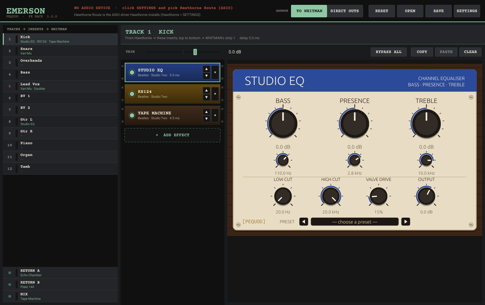

# EMERSON

The FX rack for Hawthorne and WHITMAN, from PEQUOD. Each tape track gets its own chain of inserts, played on PEQUOD's studio processors, before it reaches WHITMAN's strip. There are two FX returns for WHITMAN's sends, and a chain on the mix on its way back to Hawthorne's 2-track master.

```
Hawthorne ──Hawthorne Route──> EMERSON  each track's inserts ──EMERSON Link──> WHITMAN
Hawthorne <──Hawthorne Route── EMERSON  MIX chain           <──EMERSON Link── WHITMAN's mix
                               EMERSON  RETURN A / B         <─────────────>  WHITMAN's sends / returns
```



Everything runs on Hawthorne's clock: sample-locked, with no drift and no resampling. Hawthorne Route only takes one program, so EMERSON goes on it, and WHITMAN gets its tracks from EMERSON over the **EMERSON Link**. The link is built into both programs, so there's nothing extra to install.

## Setting up

1. **Hawthorne**: start it. Hawthorne Route must be installed (Hawthorne → SETTINGS).
2. **EMERSON → SETTINGS**: device type **ASIO**, device **Hawthorne Route**. On first run EMERSON picks it by itself.
3. **WHITMAN → SETTINGS**: device type **EMERSON Link**, device **EMERSON**.
4. **Hawthorne's ROUTING**, as for WHITMAN on its own: set the master **L / R inputs** to **ROUTE master L / R**, and switch **MIX** off on every track.

The top bar shows what EMERSON sees, for example `HAWTHORNE ROUTE · REEL: … · 24 TRACKS · 48.0 kHz · WHITMAN CONNECTED · MIX BACK 10.7 ms · TRACK DELAY 5.0 ms`, or what's missing.

## The rack

On the left is one row per tape track (names and armed lamps come from Hawthorne), then **RETURN A**, **RETURN B** and **MIX**. Click a row to see its chain on the right.

* **+ ADD EFFECT** picks a PEQUOD studio processor, grouped as EQ, compressors and limiters, gates, consoles and channel strips, tape, echo and delay, plates and springs, rooms and chambers, studio modulation, and character. Amps, cabs and guitar pedals stay in PEQUOD Host.
* Signal runs **top to bottom**. ▲ ▼ move a unit, × takes it out, and the lamp bypasses it. Right-click a unit to insert one before or after it.
* The picked unit's own panel shows beside the chain. It's the same panel as in PEQUOD Host and the VST3s, with the same presets.
* **TRIM** sets the track's level into its chain. On the returns and the mix, **LEVEL** sets what comes out.
* **BYPASS ALL**, **COPY** / **PASTE** (also *Paste chain to every track*, on a row's right-click menu) and **CLEAR**.
* Double-click a track's name to rename it in EMERSON. Clear the name to follow Hawthorne again.

**Keeping the tracks in time.** Some processors delay the sound a little, tape machines most of all. EMERSON delays every track to match the slowest chain, so the tracks stay in time with each other whatever is on them. **TRACK DELAY** in the top bar shows the delay. A bypassed unit keeps its delay, so bypassing never shifts the timing.

**The mix comes back one buffer later**, plus any delay on the MIX chain (**MIX BACK** in the top bar). This only matters when you print the mix against the tape.

**FX returns.** On WHITMAN's desks with an echo send (the REDDs and TGs), **ECHO** goes to **RETURN A** and comes back on WHITMAN's **ECHO RETURN**. Put Studio Two's **Echo Chamber** on it, or a plate or a tape echo. (In WHITMAN, SETTINGS → ECHO THROUGH EMERSON switches back to WHITMAN's own chamber.) **RETURN B** is wired through the link, ready for a second send.

**Collections outside the engine.** Most PEQUOD plugins are built into EMERSON, from the same engine PEQUOD Host uses, so there's nothing to scan. The collections that aren't in the engine yet (Pink Floyd's, Joe Meek's and Albini's: EMT Plate, Black Box EQ and Limiter, Analog Tape, the Meek and Albini rooms…) load from their installed VST3s. EMERSON looks in the VST3 folder on first run. To look in another folder, use **+ ADD EFFECT → Look for PEQUOD VST3s**. Only files named like a studio processor are opened.

The rack is kept between runs automatically. **SAVE** / **OPEN** keep racks as `.emerson` files, and **RESET** takes every effect off.

## Direct outs (for a hardware desk)

Click **OUTPUT: DIRECT OUTS** in the top bar. Each processed track then goes back into Hawthorne instead of to WHITMAN, and Hawthorne plays it out of the interface output you pick for it. Click a track's **OUT** box to pick one, or choose *From this track down* to number them in order. Hawthorne owns the interface, so the tracks stay sample-locked to the tape. The desk's stereo mix comes back into Hawthorne's master inputs as usual.

EMERSON passes the patch to Hawthorne through shared memory (`EmersonLink.h`, `emerson::directout`). **Hawthorne has to support it**: the routing change on Hawthorne's side ("Route returns to interface outputs") is a separate Hawthorne update. Until then, DIRECT OUTS sends the tracks back to Hawthorne on Hawthorne Route's track inputs, and they go no further.

## Building

The Windows build (GitHub Actions, `.github/workflows/build-windows.yml`) checks out the public **PEQUOD-HOST** repo next to this one. It builds the PEQUOD engine from PEQUOD Host's `engine/` (Rust) and compiles PEQUOD Host's `PequodNative.cpp` / `PequodPanel.cpp` into EMERSON. The plugins and their panels are therefore always the same as PEQUOD Host's. The workflow then runs the engine tests (`Tests/EmersonTests.cpp`: chains, latency alignment, mono tracks through stereo plugins, saving, Route names, the studio list and both ends of the EMERSON Link) and makes the installer.

Locally:

```
git clone https://github.com/ShallowMouse/PEQUOD-HOST pequod-host
cargo build --release -p pequod_engine --manifest-path pequod-host/engine/Cargo.toml --target x86_64-pc-windows-msvc
cmake -S . -B build -A x64 -DEMERSON_BUILD_TESTS=ON
cmake --build build --config Release
```

Installers and updates: see `Installer/README.md`. EMERSON publishes to `ShallowMouse/Emerson-Releases` with its own `RELEASES_TOKEN`.
